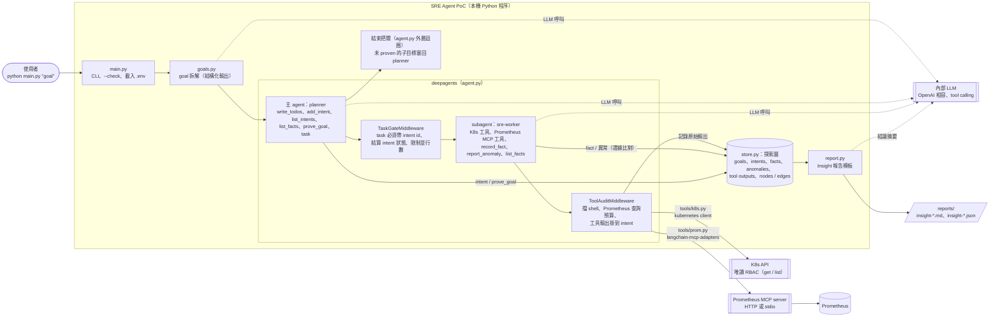
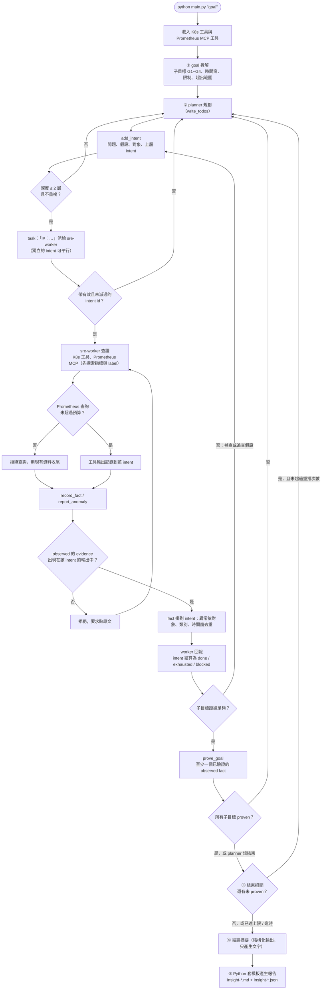
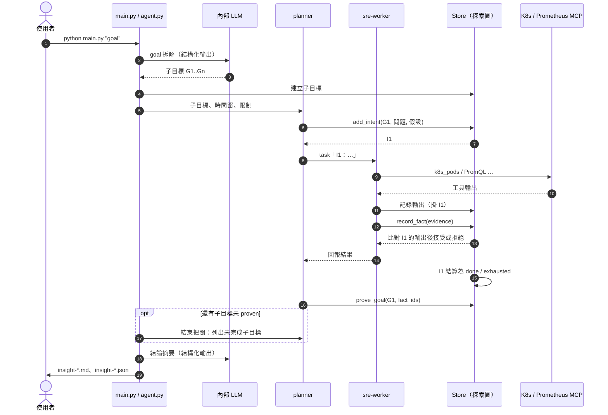

# SRE Agent PoC 架構與流程

依目前程式碼（deepagents 0.7.41）整理。圖檔版本在同資料夾的 `architecture.png`、`flow.png`、`sequence.png`。

## 1. 架構圖

所有資料工具都只讀不寫。worker 的工具呼叫一律經過 ToolAuditMiddleware，planner 的派工一律經過 TaskGateMiddleware。

## 2. 流程圖

## 3. 一次調查的時序

